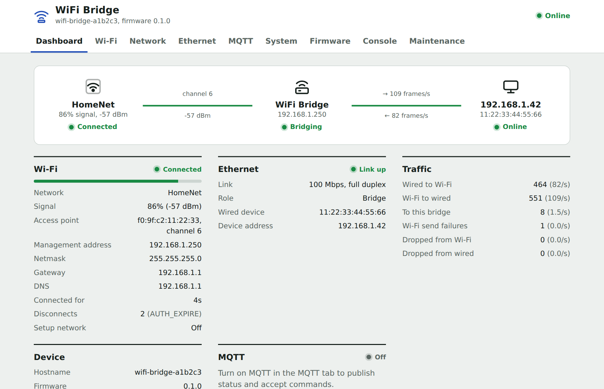
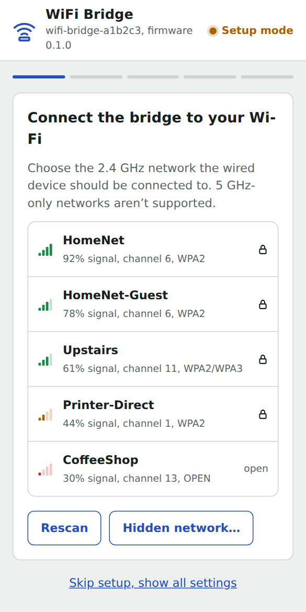
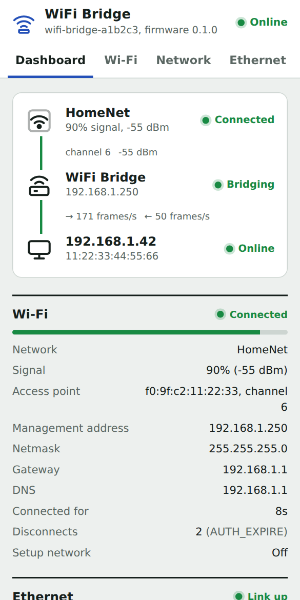
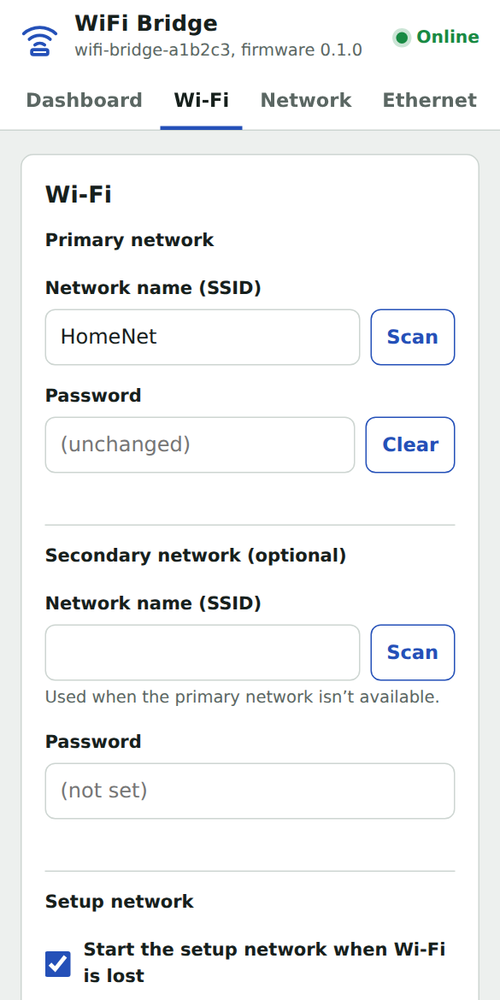
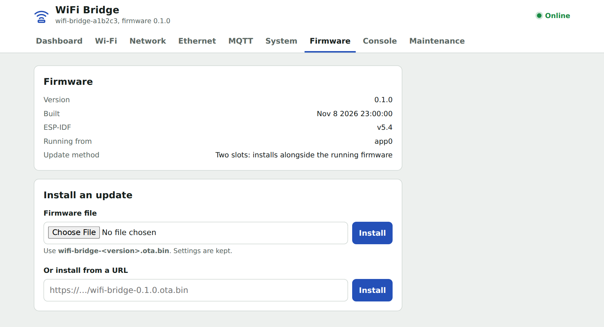

<!-- SPDX-License-Identifier: Apache-2.0 -->
# WiFi Bridge

WiFi Bridge puts a wired-only device on Wi-Fi. Install it on an ESP32 Ethernet board such as the
**WT32-ETH01**, plug your printer, NAS, or game console into the board's Ethernet port, and the device joins
your Wi-Fi network as if it were cabled to the router.

- Set up from a phone or a laptop. You don't need an app or other software.
- Check status, change settings, install updates, and read logs on the bridge's web page.
- Install firmware updates over the network. If a new version can't connect, the bridge goes back to the
  previous one.
- Optionally, connect the bridge to MQTT and Home Assistant.



## Install

1. In Chrome or Edge, open the **[web installer](https://imduffy15.github.io/wifi-bridge-installer/)**.
2. Connect the board over USB and click **Install**. The WT32-ETH01 needs a 3.3 V USB-serial adapter; the
   installer page shows the wiring.
3. When the installer asks, enter your Wi-Fi network. The installer then shows a link to the bridge's page.
   To set up from a phone instead, skip this step.

To install from the command line, download `wifi-bridge-<version>.factory.bin` from
[Releases](../../releases) and run:

```sh
esptool.py --chip esp32 write_flash 0x0 wifi-bridge-<version>.factory.bin
```

## Set up

If you skipped the Wi-Fi step in the installer, the bridge starts its own access point, the *setup
network*:

1. From your phone, join **`wifi-bridge-xxxxxx`**. The setup page opens automatically. If it doesn't, go to
   `http://192.168.4.1/`. You can also plug a laptop into the Ethernet port and go to `http://192.168.5.1/`.
2. Choose your 2.4 GHz network and enter its password. The bridge tests the connection.
3. Accept the suggested management address, or enter another address outside your router's DHCP range.
   Click **Save and restart**.
4. Rejoin your usual Wi-Fi network and open the address shown, or `http://<hostname>.local/`.
5. Plug in your wired device. It gets its IP address from your router as usual.

The *management address* is the bridge's own fixed IP address. You use it to open the bridge's page.



## How it works

Wi-Fi lets each client use only its own MAC address (the hardware address of its network interface), so
the bridge puts the wired device on Wi-Fi under the board's MAC address. Your router sees one client and
gives that client's address to the wired device. That's why the bridge's page uses a separate, fixed
management address.

The bridge might not detect a wired device that has a fixed IP address until the device sends traffic. If it
isn't detected, enter its MAC address under **Ethernet > Always bridge one specific device**.

## Use the bridge's page

The **Dashboard** shows whether each link works: Wi-Fi, the bridge, and the wired device. The other tabs
let you change settings, install firmware updates, read the log, back up settings, and reset the bridge.

 

The page has no password by default. If other people share your network, set an **Admin password** on the
**System** tab.

You can also run [commands](docs/commands.md) on the serial port (115200 baud), in the page's
**Console**, over HTTP, and over MQTT. For integrations, see the [HTTP API](docs/API.md).

## Update the firmware

On the **Firmware** tab, choose `wifi-bridge-<version>.ota.bin` and click **Install**. Your settings are
kept. If the new version can't reach Wi-Fi or its page within 10 minutes, the bridge goes back to the
previous version.



## Reset and recover

| To | Do this |
|---|---|
| Change Wi-Fi and keep other settings | On the **Maintenance** tab, click **Reset Wi-Fi settings**. This also clears the management address. |
| Start over | On the **Maintenance** tab, click **Reset everything**. Or switch the board off and on 6 times, each time within 10 seconds. |
| Reach a bridge that lost its Wi-Fi | Wait 3 minutes. The bridge opens the setup network again and keeps trying to reconnect. |
| Recover from a bad update | Nothing. A new version that crashes or can't connect goes back to the previous one. Firmware that crashes 3 times in a row, each within a minute of starting, opens only its setup page. |

## Supported boards

| Board | Status |
|---|---|
| WT32-ETH01 | Tested |
| Olimex ESP32-POE / POE-ISO, Olimex ESP32-Gateway, Espressif ESP32-Ethernet-Kit, wESP32, LilyGO T-Internet-POE | Presets, not yet tested on hardware |
| Other ESP32 boards with an RMII Ethernet PHY | Choose **Custom** on the **Ethernet** tab |

The board needs 4 MB of flash. After you install the firmware, choose your board on the **Ethernet** tab.

## Limitations

- One wired device per bridge.
- IPv4 only.
- You can't open the bridge's page from the wired device itself. Use another device on your Wi-Fi network.
- Throughput is a few Mbit/s: enough for printers and appliances, but not for large file copies.
- Access points with client isolation block traffic between Wi-Fi clients, including the wired device.

## Troubleshooting

- **You can't find the bridge.** The bridge uses the management address you chose during setup, not an
  address from your router. Try `http://<hostname>.local/`, or wait 3 minutes for its setup network.
- **The wired device doesn't get an address.** Check the cable and the **Wired device** status on the
  **Dashboard**.
- **Ethernet shows a fault.** The board preset is wrong. Choose the right board on the **Ethernet** tab.
- **You forgot the admin password.** On the serial port, send `WebPassword "`, or reset everything.
- **You need more detail.** The serial port (TX0/RX0, 115200 baud) shows the full log and accepts commands.

## Contributing

For building, testing, and the code layout, see [CONTRIBUTING.md](CONTRIBUTING.md).

## Credits

WiFi Bridge is an independent project. Its approach to device setup and maintenance is inspired by
[Tasmota](https://tasmota.github.io/) and [ESPHome](https://esphome.io/): a setup network with a captive
portal, one web page for everything, and firmware updates over the network. Its command names and MQTT
topics follow Tasmota's conventions, so existing tools work with it. It doesn't include code from either
project.

WiFi Bridge uses [ESP-IDF](https://github.com/espressif/esp-idf), the
[Improv Wi-Fi](https://www.improv-wifi.com/) protocol, and
[ESP Web Tools](https://github.com/esphome/esp-web-tools) for the web installer. The bridging code started
from ESP-IDF's `sta2eth` example.

## License

WiFi Bridge is licensed under the Apache License 2.0. See [LICENSE](LICENSE) and [NOTICE](NOTICE).
